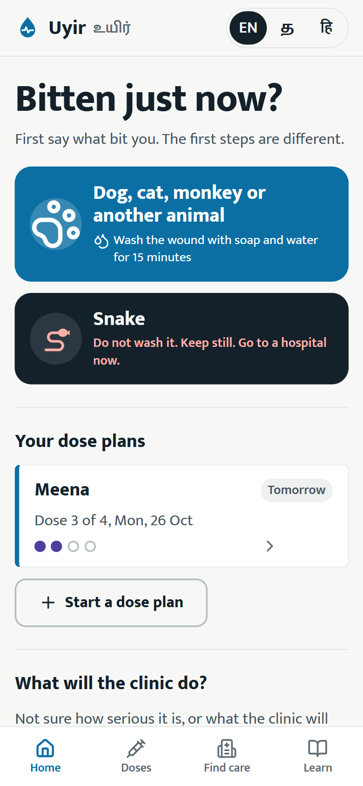
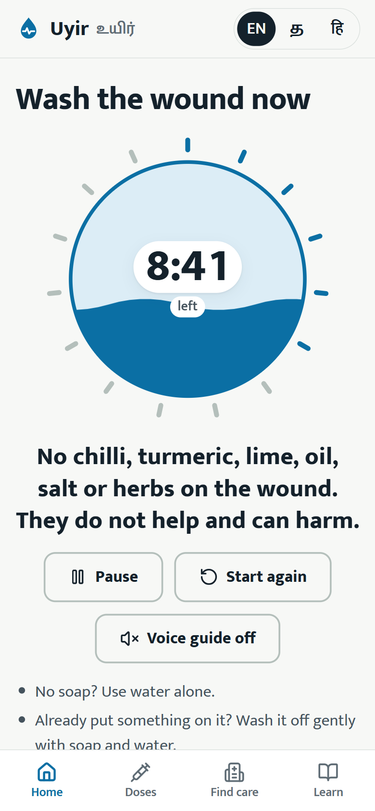
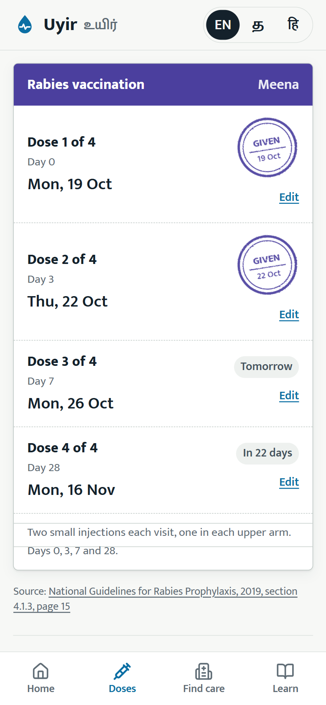
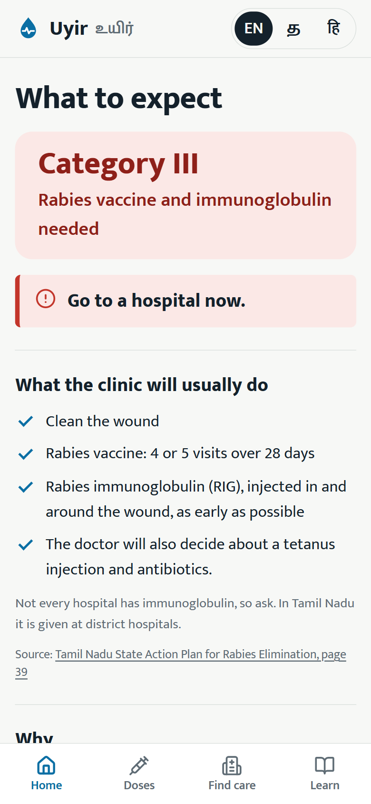
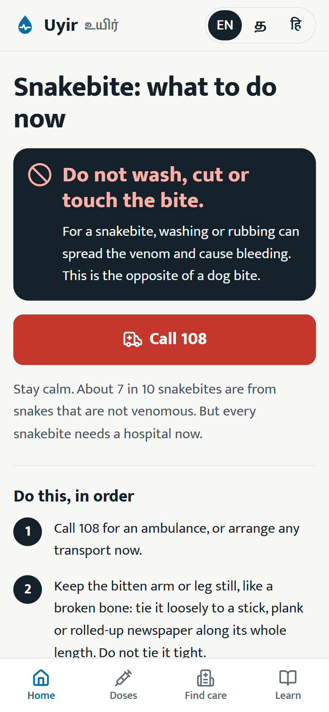
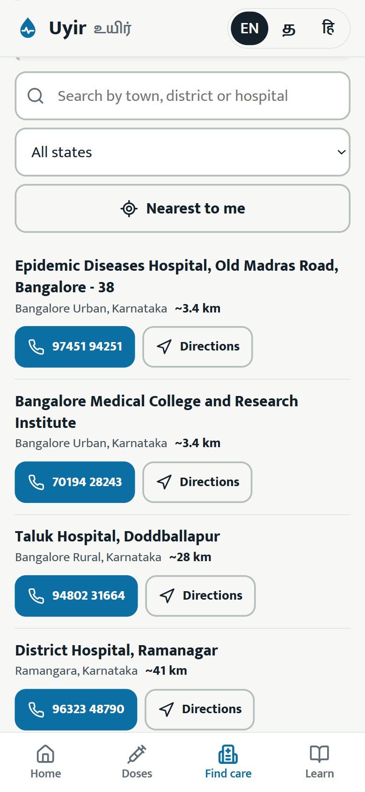
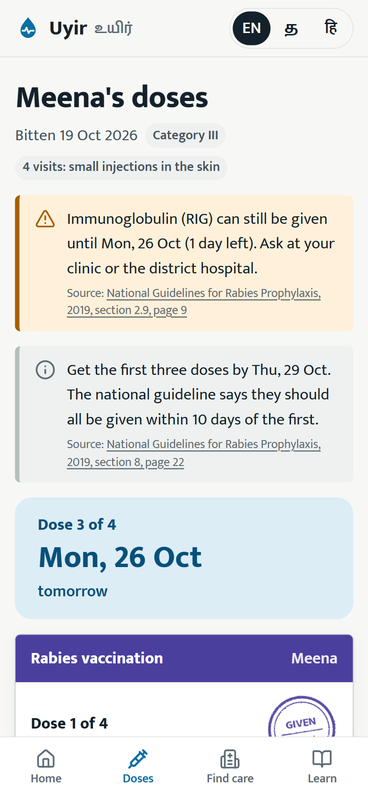
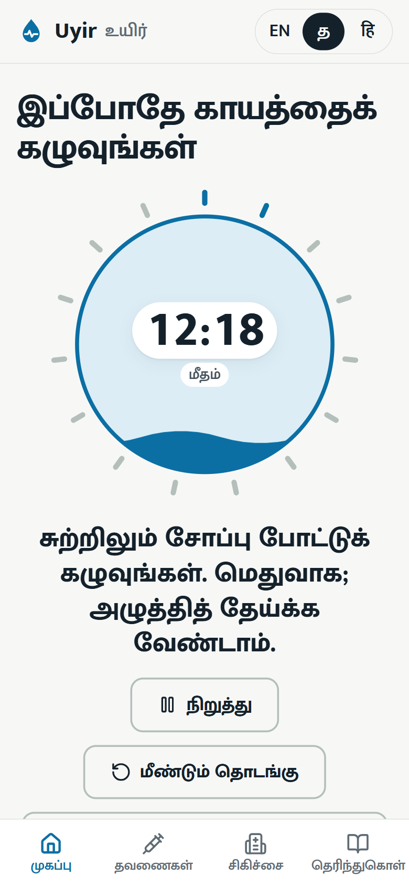

# Uyir (உயிர்): first aid after a bite, and every rabies vaccine dose after it

**A dog bites your child. Uyir starts a 15-minute wash timer that talks you through it in
Tamil, Hindi or English, tells you what the clinic will do and where the nearest one is, then
turns the national vaccine schedule into a plan with the dates, the 10-day rule, the
immunoglobulin deadline and reminders, so no dose is missed.**

Rabies is almost always fatal once symptoms start, and almost always preventable with timely,
correct care. In India the vaccine is on the government's free essential-drug list, but only
about 57% of people finish the course. Uyir is built around that gap. It works offline, keeps
everything on the phone, and every medical statement in it shows the Indian government guideline
page it comes from.

**Open it: https://havenleno22.github.io/uyir/** (works on any phone browser; add it to the home
screen to keep it offline).

<p>
  
  
  
</p>

## Why

- **37,15,713 dog bites** were recorded in India in 2024; Tamil Nadu had 4,80,427, second only
  to Maharashtra.
- A national survey estimates **5,726 rabies deaths a year**; surveillance recorded 54 in 2024.
- **About 57%** of people finish post-exposure prophylaxis (pooled from 30 Indian studies), with
  drop-outs blamed on cost, lost wages, distance, forgotten dates and beliefs.
- The national guideline says most failures follow late vaccination, no immunoglobulin in a
  severe bite, or an incomplete course, and that chilli, turmeric and lime on a wound do harm.
- **Snakebite kills about 58,000 Indians a year**, and its first aid is the opposite of a dog
  bite's: do not wash the wound.

The government publishes the rules, a clinic list (a 29-page PDF) and a phone helpline in five
states. Nothing turned those rules into a personal plan that follows someone through 28 days,
in their language, without data.

## What it does

- **The first fork: what bit you?** Dog, cat, monkey or another animal goes to the wash timer.
  Snake goes to snakebite first aid, which starts with "do not wash".
- **Wash timer.** 15 minutes of soap and running water. The bowl fills as the minutes pass, a
  voice speaks each step (in the phone's own Tamil, Hindi or English voice), the screen stays
  awake, and the timer survives the phone locking.
- **What will the clinic do?** Four short questions map what happened to the national exposure
  categories and the guideline's special cases: wild animals and forests, bleeding, weak
  immunity, chloroquine, earlier vaccination, rats and rabbits, bats. It says what to expect
  (wound care, vaccine, immunoglobulin) and how urgent it is, with the reason and page for each
  point. It prepares the person; the doctor decides.
- **Dose plan, drawn as the clinic's card.** The 4-visit (intradermal), 5-visit (intramuscular),
  re-exposure and pre-exposure schedules. Each dose given gets a violet rubber stamp. The
  guideline's rules run underneath: first three doses within 10 days, "one or two days late does
  not mean starting again", see the doctor when an early dose is missed, and a countdown for
  immunoglobulin (no later than day 7). The clinic's own dates override the standard ones.
- **10-day animal watch.** For a dog or cat that can be seen again: a daily check. If it falls
  sick, dies or disappears, an urgent message to tell the doctor today.
- **Reminders without a server.** A calendar file with alerts the evening before and at the visit,
  Google Calendar links, and the dates sent on WhatsApp or SMS to yourself or a family member.
- **Find care, offline.** The 284 official Model Anti-Rabies Clinics, searchable by town or
  district and sorted by distance, with call and directions buttons. Helplines 108, 112 and the
  rabies helpline 15400. Honest about the gap: the official list has no clinics in Tamil Nadu, so
  it explains where Tamil Nadu gives the vaccine (every government facility, including PHCs) and
  immunoglobulin (district hospitals). Nearby hospitals from OpenStreetMap when online.
- **A record for the clinic.** The fields of the government's Animal Bite Exposure Register, as
  text and a QR code any phone camera reads. Printable.
- **Myths and facts**, each with its source: diet during the vaccine, vaccinated dogs, "watch the
  dog for 10 days", 14 injections in the stomach, pregnancy, children's dose, missed doses, milk.
- **English, தமிழ், हिन्दी**, set in Mukta and Mukta Malar.

<p>
  
  
  
</p>
<p>
  
  
</p>

## Where the medical content comes from

Every rule is traced to its source in [docs/sources.md](docs/sources.md), mainly:

- National Guidelines for Rabies Prophylaxis (NRCP, 2019): schedules, categories, the 10-day
  rule, immunoglobulin, special cases, FAQs. The PDF is a scan; `scripts/extract-pdf-scans.mjs`
  pulls out the page images so it could be read page by page.
- NRCP wound management guidelines and website FAQ (first aid, helpline, milk, symptom timing).
- MoHFW Standard Treatment Guidelines for snakebite (2017).
- Tamil Nadu's State Action Plan for Rabies Elimination (where vaccine and immunoglobulin are given).

Uyir never tells anyone to skip, stop or restart a dose, never gives a dose amount, and never
says a bite is safe without the guideline's own rule: when in doubt, start the vaccine.

## Engineering highlights

- **A tested rules engine** (`src/engine/`, pure TypeScript): calendar-day arithmetic that can't
  shift a dose across time zones, the regimens, the plan and its late-dose rules, the exposure
  assessment, the animal watch, the calendar file (RFC 5545, with UTF-8-safe line folding for
  Tamil), the clinic search, and the register record. `npx vitest run` runs 62 tests in about
  2 seconds, including one that decodes the QR code with an independent decoder and checks it
  matches the record exactly, Tamil name included.
- **Official PDFs to app data.** `scripts/build-clinics.mjs` reads the clinic table by text
  position (pdf.js), keeps only dialable numbers (and flags the 3 broken ones in the official
  list instead of guessing), and drops doctors' names and emails. `scripts/geocode-clinics.mjs`
  adds coordinates from OpenStreetMap once, within its usage policy: the hospital itself where
  OpenStreetMap knows it (60), its town or village (35), its PIN code area (56), else the
  district centre (133), each checked against the clinic's state and district.
- **Emergency screens first.** The first download is about 69 KB of JavaScript (gzipped). The
  other screens, the Tamil and Hindi text and the clinic list load on demand.
- **Offline, tested properly.** A build step writes every built file into the service worker, so
  the whole app is cached on the first visit. Verified by stopping the server and reloading: all
  screens load, in Tamil, from the cache. New versions take over on the next launch, so an open
  page never mixes files from two builds.
- **Accessible.** Lighthouse (mobile): 100 for accessibility, best practices and SEO on the home,
  wash, check, plan, care and learn screens. Radio groups follow the ARIA keyboard pattern, focus
  moves to each new screen's heading, nothing relies on colour alone.
- **Translations checked by tests:** Tamil and Hindi must have every key, list length and message
  function of the English, with no leftover English sentences.

## Run it

```bash
npm install
npm run dev
```

Then open http://localhost:5173.

```bash
npx vitest run
npm run build
```

Data scripts (the PDFs go in `data-sources/`, see [docs/sources.md](docs/sources.md) for links):

```bash
node scripts/build-clinics.mjs data-sources/nrcp-anti-rabies-clinics-2026-03.pdf
```

`node scripts/geocode-clinics.mjs` fills in missing clinic coordinates (cached in
`scripts/clinic-geocodes.json`), and `node scripts/make-icons.mjs` re-renders the PNG icons.

## Project structure

```
src/engine/    dates, regimens, dose plan, exposure check, animal watch, calendar, clinics, record (tested)
src/data/      the clinic list (built from the official PDF), sources and citations
src/ui/        screens (React); emergency screens load first, the rest on demand
src/lib/       speech, QR, formatting, sharing, OpenStreetMap search
src/i18n/      English, Tamil, Hindi
sw/            the service worker template (filled in at build time)
scripts/       PDF text and scan extraction, clinic table parser, geocoder, icons
tests/         Vitest suites
docs/          design, sources, how it works, interview guide, screenshots
```

## Limits

- It is not a doctor and not a substitute for one. It follows India's national guidelines and
  says so on every screen that gives advice.
- Reminders depend on the person adding them to a calendar or sending them on WhatsApp; a web
  app with no server cannot send notifications on its own schedule.
- Some clinic distances are approximate: 133 of the 284 clinics are placed at their district's
  centre (marked "~"). The official list itself has gaps (no clinics for several large states)
  and three unreadable phone numbers.
- The Tamil and Hindi text is a careful translation, not yet reviewed by native-speaking
  clinicians.
- Voice guidance needs the phone to have a voice for the language (most Android phones do).

## Credits and data

- Medical content: National Rabies Control Programme, NCDC, and the Ministry of Health and Family
  Welfare, Government of India; Government of Tamil Nadu. See [docs/sources.md](docs/sources.md).
- Clinic list: NRCP, List of Anti Rabies Clinic (26 March 2026). Coordinates and nearby hospitals:
  © OpenStreetMap contributors (ODbL), via Nominatim and Overpass.
- Typefaces: Mukta and Mukta Malar by Ek Type (SIL Open Font License). Icons: Lucide. QR codes:
  qrcode-generator (MIT).

## License

The code is under the [MIT License](LICENSE). The data has its own terms: the medical content is
summarised from Government of India and Government of Tamil Nadu documents (cited in
[docs/sources.md](docs/sources.md)); the clinic list comes from the National Rabies Control
Programme; the clinic coordinates in `src/data/clinics.json` and `scripts/clinic-geocodes.json` are
derived from OpenStreetMap data, © OpenStreetMap contributors, and are available under the
[Open Database License](https://opendatacommons.org/licenses/odbl/).

## Author

Built by **Haven Leno J**, B.Tech CSE student at SRM Institute of Science and Technology,
Ramapuram, with Claude (Anthropic) as an AI pair programmer.

- Portfolio: https://havenleno22.github.io/
- GitHub: https://github.com/HavenLeno22
- LinkedIn: https://www.linkedin.com/in/havenleno
